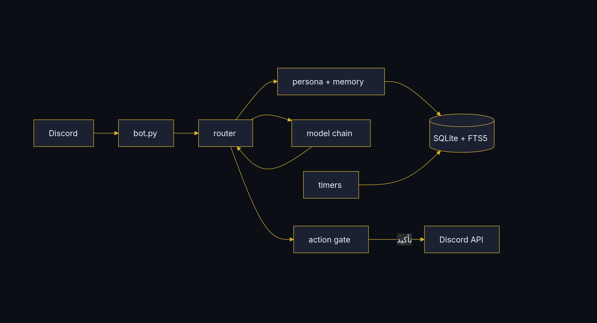
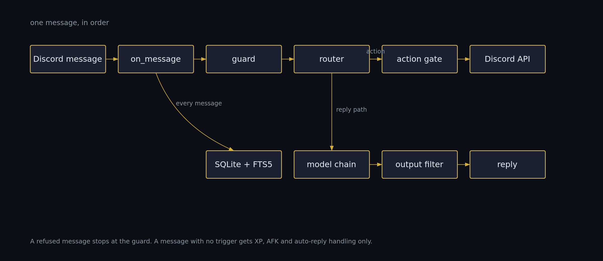
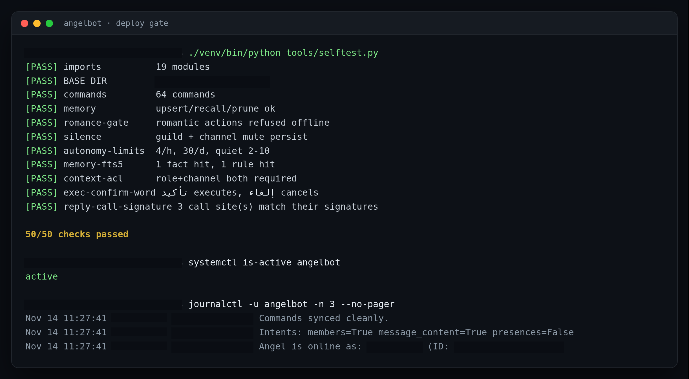
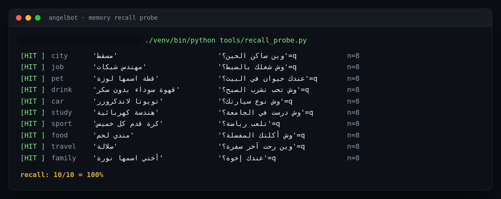

<div align="center">

# أنجل

**بوت ديسكورد عربي لسيرفرات المجتمع.**

[**الموقع**](https://angel.aetherisnode.cloud/) · [English](README.md)

[](https://www.python.org/) [](https://discordpy.readthedocs.io/) [](https://www.sqlite.org/fts5.html) [](LICENSE) [](https://github.com/Certainty7/angelbot/releases/tag/v1.0.3)

[نظرة عامة](#نظرة-عامة) · [المزايا](#المزايا) · [البنية](#البنية) · [البدء السريع](#البدء-السريع) · [الإعدادات](#الإعدادات) · [الأوامر](#الأوامر) · [النشر](#النشر) · [الاختبار](#الاختبار) · [الأمان](#الأمان) · [المساهمة](#المساهمة)

</div>

---

## نظرة عامة

أنجل بوت ديسكورد عربي لسيرفرات المجتمع. يحتفظ بأرشيف قابل للبحث للرسائل التي يراها، ولا يحفظ عن أحد إلا ما يثبّته بنفسه، ويشغّل أوامر الإشراف بعد خطوة تأكيد صريحة، ويحوّل روابط التواصل الاجتماعي إلى ملفات، ولا
يبدأ قبل أن تنجح بوابة فحص محلية.

البوت عملية asyncio واحدة. تُخزَّن بيانات الأرشيف والذاكرة المثبّتة وحالة المحادثة في SQLite مع FTS5،
ويدير systemd دورة حياة الخدمة، ويتولّى توليد النص سلسلة نماذج مجانية بالكامل مع تبريد وتبديل
احتياطي: `gemini-3-flash-preview` ثم `gemini-3.1-flash-lite` ثم `gemini-3.5-flash-lite` ثم
`gemini-4-hydrogen`. وخطأ `429` اليومي في الطبقة المجانية يُبرَّد حتى منتصف ليل Pacific بدل إعادة
المحاولة مع كل رسالة. ولا يوجد طابور خارجي ولا ذاكرة مؤقتة ولا عامل خارجي.

يقوم معظم التصميم على التحفّظ: يمكن للنموذج أن يقترح إجراءً إشرافيًا، لكنه لا يُنفَّذ إلا بعد أن يؤكده من طلبه، وتُعاد مراجعة الصلاحية عند التنفيذ. ولا
يُحتفظ بأي حقيقة عن عضو إلا إذا كتبها بنفسه بأمر `/memory pin`؛ لا يستنتج البوت شيئًا من رسائله.

## المزايا

- **محادثة عربية أولًا.** يرد أنجل بالعربية افتراضيًا، مع شخصية قابلة للضبط، وذاكرة يثبّتها العضو
  بنفسه بـ `/memory pin`، وطبقة ذاكرة للتفضيلات الثابتة.
- **استدعاء محدود النطاق من الأرشيف.** تُفهرس الرسائل التي يراها البوت بـ SQLite FTS5، وتُقصر النتائج
  على القنوات التي يستطيع السائل قراءتها، وتبقى الرسائل الخاصة خارج أرشيف السيرفر.
- **ذاكرة صريحة فقط.** لا يُستنتج شيء من رسائل أحد. يثبّت العضو ما يريد تذكّره بـ `/memory pin`،
  ويمسح معلومة واحدة بـ `/memory forget`، ويمسح كل شيء بـ `/data`. ولا يبني البوت أي ملفات تعريفية.
- **إشراف محمي.** الطرد والحظر والكتم المؤقت والمسح والتحذيرات والقفل والوضع البطيء والأدوار
  والإعلانات، مع سجل إشراف وحاجز ضد الإغراق. تُوضع الإجراءات المدمّرة في طابور، وتتطلب أن يكتب المالك
  نفسه `تأكيد` خلال 60 ثانية، وتُعاد مراجعة الصلاحيات عند وصول التأكيد.
- **استخراج وسائط.** تُحلّ روابط TikTok وX عبر واجهاتهما العامة، مع yt-dlp بديلًا؛ ويعود Instagram
  بالـ embed أو بملفات الشرائح التي يقدّمها المصدر؛ وتُعاد كتابة روابط Reddit إلى embed. وتجري
  التنزيلات في عملية فرعية ضمن حدود للوقت والحجم، وتُحذف الملفات المؤقتة بعد الإرسال.
- **أدوات مجتمع.** XP والرتبة والسمعة والسحوبات والتذاكر والاستطلاعات وAFK وsnipe والردود التلقائية
  والرسائل المثبتة وautorole.
- **موسيقى.** أوامر `/play` و`/skip` و`/queue` و`/playlist` عبر واجهة الصوت العامة. يبدأ البحث من
  SoundCloud، ويحتاج يوتيوب إلى ملف cookies وبيئة تشغيل JavaScript، ويمكن تعطيل كليهما.
- **استقلالية اختيارية.** رسائل يبدأها البوت، مع ساعات هادئة، وحدود ساعية ويومية، وحد أدنى لعدد
  المتحدثين، وفاصل لكل قناة.
- **ضوابط تشغيل.** وحدة systemd، وبوابة فحص محلية، ولقطة مقاييس، ومؤقّت نسخ احتياطي.

## البنية



تدخل أحداث ديسكورد عبر `bot.py`، ثم يتولّاها `angel/client.py`، ويوجّهها `angel/nl_router.py`. يقرأ
الموجّه الشخصية والذاكرة، ويستدعي سلسلة النماذج عند الحاجة إلى رد مولّد، أو يسلّم إجراءً طلبه النموذج
إلى بوابة الإجراءات. وتتحقق البوابة من معرّف ديسكورد الثابت للفاعل، ومن الصلاحية المطلوبة، ومن كلمة
تدل على النية، قبل أن يصل أي شيء إلى Discord API.



<p align="center"><sub>مسار الرسالة داخل البوت: كل رسالة يراها البوت تُؤرشف، والرد يمرّ بسلسلة النماذج ثم فلتر المخرجات.</sub></p>

الأرشيف ملف SQLite واحد مع FTS5. يحفظ `server_messages` الرسائل الخام، و`server_messages_fts` فهرس
البحث، ويحفظ جدول التفضيلات الملاحظات التي يثبّتها العضو بنفسه. لا توجد حالة خارجية: ملف قاعدة البيانات هو المصدر.

لا توجد أداة تبني ملفات ولا مستخرج ليلي: أُزيل الاستنتاج التلقائي كي لا يبني البوت ملفاً عن أحد من
بيانات الواجهة. الذاكرة صف واحد لكل عضو، يكتبه العضو بنفسه.

## البدء السريع

### المتطلبات

- Python 3.12
- git وffmpeg
- تطبيق ديسكورد مع تفعيل نية Message Content
- مفتاح Gemini API
- اختياري: نية Server Members لـ autorole وسجل الانضمام؛ وDeno 2.9+ و`yt-dlp-ejs` ليوتيوب؛ وملف
  `cookies.txt` إذا طلب يوتيوب ذلك

### التثبيت

```bash
git clone https://github.com/Certainty7/angelbot.git
cd angelbot
python3.12 -m venv venv
source venv/bin/activate
python -m pip install --upgrade pip
pip install -r requirements.txt
```

الإصدارات المثبّتة في `requirements.txt` مهمة. يطلب `discord.py[voice]` الإصدار `PyNaCl<1.6`، بينما
يحتاج DAVE الإصدار `PyNaCl==1.6.2`. ويحتوي الملف على التركيبة التي تُحلّ بلا تعارض، أما استخدام
الامتداد `[voice]` بدلًا منه فيفشل بـ `ResolutionImpossible`.

### الإعداد

```bash
cp .env.example .env
$EDITOR .env
```

على الأقل اضبط `DISCORD_TOKEN` و`MALAK_OWNER_ID` و`GEMINI_API_KEY`. ويرفض البوت البدء إذا كان معرّف
المالك مفقودًا أو غير رقمي، لأن فقدان صلاحية المالك بصمت أسوأ من فشل البدء.

### التحقق

```bash
python tools/selftest.py
```

يجب أن ينتهي تشغيل بوابة الفحص بـ `50/50 checks passed`. تستورد البوابة كل وحدة، وتبني قاعدة بيانات
مؤقتة، وتفحص المخطط ومشغّلات FTS، وتمتحن مسارات الذاكرة والأرشيف، وتحسب الأوامر المسجلة، وتشغّل حالات
فلتر المخرجات. وهي لا تتصل بديسكورد ولا بمزوّد نماذج. أما مسار الاختبار الكامل فهو: `pytest -q`
(56 اختبارًا و322 subtest)، و`tools/selftest.py` (50/50)، وفحوص الأمان والاستدعاء، واختبارات الموقع
(67 اختبار Playwright).

### التشغيل

```bash
python bot.py
```

ينشئ التشغيل الأول `chat_history.db` والمخطط. ولتشغيل دائم استخدم
[`deploy/angelbot.service`](deploy/angelbot.service).

### الدعوة

في بوابة مطوّري ديسكورد، افتح **OAuth2 → URL Generator**:

- النطاقات: `bot`، `applications.commands`
- الصلاحيات: Manage Roles، Manage Channels، Kick Members، Ban Members، Moderate Members،
  Manage Messages، Read Message History، Send Messages، Embed Links، Attach Files، Add Reactions،
  Connect، Speak

افتح الرابط الناتج. في **Bot → Privileged Gateway Intents**، فعّل **Message Content**. وفعّل
**Server Members** فقط إذا احتجت autorole وسجل الانضمام، ثم اضبط `ENABLE_MEMBERS_INTENT=1`. وإذا كان
المفتاح في البوابة مغلقًا والمتغير `1`، يرفض ديسكورد تسجيل الدخول بـ `PrivilegedIntentsRequired`.

### فحوص أولية

- `/ping` يرد.
- `/help` يعرض الأوامر المسجلة.
- `/angel` يفتح مركز التحكم.
- `/set_modlog` يحدد قناة سجل الإشراف.
- `/diagnostics` يعرض حالة سليمة.
- `python tools/selftest.py` يعطي 50/50.

## الإعدادات

توجد الإعدادات في `.env`، و`.env.example` يحمل القائمة الكاملة المشروحة، ومنها مفتاح الدفعة
الذي تستخدمه سكربتات المشغّل في `tools/`.

| المتغير | مطلوب | الوصف |
|---|---|---|
| `DISCORD_TOKEN` | نعم | رمز البوت من بوابة مطوّري ديسكورد. |
| `MALAK_OWNER_ID` | نعم | معرّف مالك ديسكورد الرقمي. |
| `GEMINI_API_KEY` | نعم | مفتاح Google AI Studio. |
| `GEMINI_API_KEY_2` | لا | مفتاح ثانٍ. وإذا وُجد الاثنان جُرّب هذا أولًا ثم عادت السلسلة إلى `GEMINI_API_KEY`. |
| `GEMINI_MODEL` | لا | معرّف النموذج الأساسي. وإذا تُرك فارغًا استُخدم الافتراضي المجاني `gemini-3-flash-preview` ثم `3.1-flash-lite` ثم `3.5-flash-lite` ثم `4-hydrogen`. |
| `MISTRESS_USER_ID` | لا | اسم بديل لـ `MALAK_OWNER_ID`، يُقرأ فقط إذا كان ذلك المتغير فارغًا. |
| `ENABLE_MEMBERS_INTENT` | لا | `1` بعد تفعيل Server Members في البوابة. يفتح autorole وسجل الانضمام. |
| `ANGEL_DB_PATH` | لا | مسار SQLite. الافتراضي `chat_history.db` في جذر المشروع. |
| `FFMPEG_PATH` | لا | مسار ffmpeg صريح. |
| `YOUTUBE_COOKIES_FILE` | لا | ملف `cookies.txt` لـ yt-dlp. |
| `MUSIC_ENABLED` | لا | `0` يوقف وحدة الموسيقى. مفعّلة افتراضيًا. |
| `MUSIC_YOUTUBE` | لا | `0` يزيل يوتيوب من سلسلة المصادر ويترك SoundCloud. |
| `MALAK_DAILY_COST_LIMIT_USD` | لا | ميزانية النماذج اليومية بالدولار. |

القائمة الكاملة المشروحة، بما فيها متغيرات الاستقلالية والأرشيف والتعبئة الخلفية، في
[`.env.example`](.env.example).

## الأوامر

يسجّل وقت التشغيل 71 أمرًا: 68 أمر سلاش و3 قوائم سياق للرسائل. تُحمَّل 67 منها مسبقًا، وتضيف وحدة
الموسيقى 4 أوامر عند تفعيلها، و`/help` فهرس مختصر داخل ديسكورد.

| المجموعة | العدد | أمثلة |
|---|---|---|
| الإشراف | 17 | `/ban`, `/timeout`, `/purge`, `/warn` |
| المجتمع | 11 | `/snipe`, `/poll`, `/giveaway`, `/ticket_panel` |
| الذاكرة | 7 | `/memory`, `/rules`, `/budget`, `/mood` |
| المحادثة | 4 | `/chat`, `/translate`, `/imagine`, `/summarize_channel` |
| الوسائط | 2 | `/fix`, `/cleanup` |
| الترفيه وXP | 4 | `/gif`, `/lore`, `/rank`, `/leaderboard` |
| التحكم | 3 | `/silence`, `/autonomy`, `/help` |
| المالك | 6 | `/sovereign`, `/harem`, `/dm_send`, `/whisper`, `/dm_logs`, `/custom_action` |
| الأنظمة الرئيسية | 6 | `/angel`, `/knowledge`, `/pulse`, `/guard`, `/diagnostics`, `/rep` |
| الإنتاجية | 2 | `/sticky`, `/autorole` |
| الإعداد | 2 | `/setup`, `/catchup` |
| قوائم السياق | 3 | تلخيص الرسالة، ترجمة وتحليل، اقتراح رد ومهام |
| الموسيقى | 4 | `/play`, `/skip`, `/queue`, `/playlist` |

المعاملات والصلاحيات لكل أمر: [docs/COMMANDS.md](docs/COMMANDS.md). ويحتاج `/autorole` إلى نية
الأعضاء، ولا تُسجّل أوامر الموسيقى إلا عند تفعيل وحدتها.

## النشر

تشغّل الوحدة `bot.py --checkpoint-db` و`tools/selftest.py` قبل كل بدء، فإذا فشلت بوابة الفحص أُلغي
البدء بدل أن يُسقِط التحديثُ البوتَ. وشغّل بوابة الفحص بنفسك قبل أي إعادة تشغيل يدوية: إعادة التشغيل تكون
قد أوقفت العملية القديمة، وفشل البوابة يترك البوت متوقفًا حتى تُصلَح الشجرة.

```bash
sudo cp deploy/angelbot.service /etc/systemd/system/angelbot.service
# عدّل User وGroup وWorkingDirectory وEnvironmentFile حسب الخادم
sudo systemctl daemon-reload
sudo systemctl enable --now angelbot.service
journalctl -u angelbot -n 30 --no-pager
```

### Docker

```bash
cp .env.example .env      # املأ DISCORD_TOKEN وMALAK_OWNER_ID وGEMINI_API_KEY
docker compose up -d --build
docker compose logs -f angelbot
```

يعمل الحاوِز بمستخدم غير جذري `angel`، والمسار الوحيد القابل للكتابة هو وحدة التخزين
`angel_data` المركّبة على `/app/data`، ويحفظ `ANGEL_DB_PATH=/app/data/angel.db` قاعدة SQLite
داخلها. لا يُضمَّن `.env` ولا `cookies.txt` في الصورة.

### ويندوز

```powershell
powershell -ExecutionPolicy Bypass -File scripts/run_windows.ps1
```

ينشئ السكربت `.venv` ويثبّت المتطلبات وينسخ `.env.example` إلى `.env` عند أول تشغيل، ثم يفحص قاعدة
البيانات ويشغّل البوت. يلزم FFmpeg للموسيقى والفيديو، ويمكن تثبيته بالأمر
`winget install Gyan.FFmpeg`.

<p align="center"></p>
<p align="center"><sub>بوابة الفحص: 50/50 فحصًا قبل بدء الخدمة.</sub></p>

### المؤقتات

الوحدة المتوفرة في [`deploy/`](deploy) هي `angelbot.service` فقط؛ أما مؤقتات الصيانة والنسخ الاحتياطي
فهي محلية في النشر المرجعي ولا تُشحن في المستودع. لا يوجد أي تجميع لملفات الأعضاء: أُزيل المسار بالكامل
من الشيفرة.

### النسخ الاحتياطي والسجلات

النسخ الاحتياطية لقطات محلية من SQLite، تحتوي الرسائل والذاكرة المثبّتة، وتُحذف بعد `14` يوماً، ولا توجد
نسخة خارج الخادم.

```bash
# نسخة موثّقة ومفحوصة (من مؤقت أو cron بمستخدم يملك كتابة مجلد النسخ)
ANGEL_DB_PATH=/opt/angelbot/data/angel.db ANGEL_BACKUP_DIR=/opt/angelbot/backups \
  scripts/backup_db.sh

journalctl -u angelbot -f
python tools/metrics.py
```

الاستعادة عكسها: أوقف الخدمة، انسخ أحدث `angel_*.db` فوق قاعدة البيانات الحية، ثم شغّل الخدمة
وتأكد من نجاح `python bot.py --verify-db`. عملية البوت نفسها لا تستطيع الكتابة في مجلد النسخ لأنه
خارج `ReadWritePaths`.

### التحديث

```bash
git pull --ff-only
python tools/selftest.py
sudo systemctl restart angelbot
journalctl -u angelbot -n 30 --no-pager
```

## الاختبار

| الأداة | الغرض |
|---|---|
| `tools/selftest.py` | 50 فحصًا محليًا: الاستيرادات، والمخطط، ومشغّلات FTS، والذاكرة، ونطاق الأرشيف، وإحصاء الأوامر، وفلتر المخرجات، وجاهزية النشر. |
| `pytest -q` | 56 اختبارًا و322 subtest (الأمان، الكاش، الوسائط، الذكاء وقاعدة البيانات). |
| `tools/security_probe.py` | يتأكد من أن محاولات الحقن يوقفها التفويض. |
| `tools/recall_probe.py` | يشغّل 10 أسئلة استدعاء تمثيلية على قاعدة بيانات مؤقتة. |
| `tools/gate_checks.py` | فحوص ثابتة تستخدمها البوابة، بما فيها قاعدة منع shell. |
| `npx playwright test` (داخل `website/`) | 67 اختبار متصفح على الموقع المبني: الصفحات، الأوامر، التجاوب، الثيم، الروابط والخصوصية. |



<p align="center"><sub>أداة فحص الاستدعاء: عشر حقائق تجريبية على قاعدة بيانات مؤقتة، وعشر أسئلة بكلمات مختلفة، تُحذف بعد الفحص.</sub></p>

تشغّل الخدمة بوابة الفحص عند كل بدء، ويشغّل التكامل المستمر (CI) الأمر نفسه. والبوابة الخضراء ضرورية
لكنها ليست كافية: فهي لا تغني عن سيرفر ديسكورد حقيقي.

## الأمان

- تعتمد فحوص المالك على معرّفات ديسكورد الثابتة، لا على الأسماء أو الألقاب.
- تُوضع إجراءات `BAN` و`KICK` و`PURGE` و`DELETE_CHANNEL` في طابور، وتتطلب أن يكتب الشخص نفسه الذي
  طلبها `تأكيد` خلال 60 ثانية. وكلمة الإلغاء تمسحه، وأي شيء آخر يتركه معلّقًا حتى تنتهي المهلة.
  وتُعاد مراجعة الصلاحية عند وصول التأكيد.
- استدعاء الأرشيف محدود بالقنوات التي يستطيع السائل قراءتها، والرسائل الخاصة مستبعدة من أرشيف السيرفر.
  وحالة AFK والرسائل المثبتة محدودة بالسيرفر.
- كل جلسة HTTP خارجية يجب أن تستخدم `SafeAsyncResolver`؛ ويُعاد التحقق من الـ redirects وروابط البث
  المخزنة حتى لا يصل تنزيل إلى loopback أو RFC1918 أو عنوان metadata.
- نصوص الدردشة والملخصات والسياق غير الموثوق تُطهَّر وتُحاط بحدود واضحة قبل دخولها البرومبت؛ وصور
  fallback يجب أن تجتاز فحص magic bytes.
- طوابير الإرسال والكاشات محدودة، ويُرفض الإرسال بعد إغلاق العميل، وخطأ `429` اليومي يُبرَّد حتى
  تجديد الحصة.
- تُسجَّل الرسائل الخاصة لأجل المالكة: اسم المرسل والنص وروابط المرفقات ورد أنجل في جدول `dm_logs`،
  وتُحوَّل الرسالة إلى خاص المالكة. ينبغي إخبار الأعضاء بذلك قبل مراسلة البوت.
- يزيل فلتر المخرجات `@everyone` والنصوص الشبيهة بالرموز والوسوم المتبقية، ويصحّح ردًّا يدّعي تنفيذ
  إجراء ما زال في الطابور.
- ترفض `tools/gate_checks.py` استخدام `create_subprocess_shell` و`os.system` و`os.popen`
  و`shell=True` في مسارات التشغيل.
- أبلغ عن مشكلات الأمان على انفراد كما هو موضح في [SECURITY.md](SECURITY.md)، بدل فتح بلاغ عام.

## قيود معروفة

- لا يعرف البوت إلا ما يثبّته العضو بنفسه، فتخصيص الردود أقل من بوت يبني ملفات: هذا هو المقايض
  المقصود، لأن سياسة ديسكورد للمطورين تمنع بناء ملفات عن المستخدمين من بيانات الواجهة.
- لا توجد نسخة احتياطية خارج الخادم بعد.
- فلتر المخرجات نسخة أولى: يلتقط الحالات الواضحة، لا كل صياغة.
- النشر المرجعي على خادم واحد بنواة واحدة وأقل من غيغابايت من الذاكرة، والمؤقتات تتشارك الميزانية
  نفسها.
- يحتاج تشغيل يوتيوب إلى ملف cookies وDeno، وبدونهما يعود البحث إلى SoundCloud فقط.
- الملاحظات المثبّتة مرتبطة بالمستخدم لا بالسيرفر: ملاحظة ثُبّتت في سيرفر تُستدعى في سيرفر آخر. أما
  الأرشيف فمحدود بالسيرفر.
- الصوت مشفّر من الطرف إلى الطرف (DAVE)، والبوت وحده في القناة الصوتية لا يستطيع التأكد من أن صوته
  يصل مسموعًا. واختبار الموسيقى يحتاج عضوًا ثانيًا في القناة.
- سلسلة النماذج تستخدم حصص Google AI Studio المجانية. وخطأ `429` اليومي يبرّد النموذج حتى منتصف ليل
  Pacific؛ استخدم `GEMINI_API_KEY_2` لمشروع ثانٍ، أو `GEMINI_MODEL` لاختيار نموذج مجاني آخر.

## الوثائق

- خريطة الوحدات والبوابات المحيطة بها: [ARCHITECTURE.md](ARCHITECTURE.md).
- كل أمر بمعاملاته وصلاحيته: [docs/COMMANDS.md](docs/COMMANDS.md).
- لماذا صار التصميم على ما هو عليه: [docs/DECISIONS.md](docs/DECISIONS.md).
- ما يحفظه البوت، وما يرفض استنتاجه، وكيف يقرأ العضو بياناته ويحذفها: [docs/MEMORY.md](docs/MEMORY.md).
- ما يعيده كل مصدر من مصادر الوسائط: [docs/GALLERY.md](docs/GALLERY.md).

## الحالة

يعمل أنجل في الإنتاج على خادم واحد. الإصدار الحالي **v1.0.3** (2026-11-19)؛ والمستودع عام ومفتوح
المصدر، والبلاغات وطلبات السحب مرحّب بها وتُراجَع على قدر الاستطاعة.

## المساهمة

اقرأ [CONTRIBUTING.md](CONTRIBUTING.md) قبل فتح طلب سحب؛ فهو يذكر الأوامر الواجب تشغيلها وصيغة رسائل
الإيداع. وتُوجَّه البلاغات والأسئلة إلى متتبّع البلاغات.

## المشرف

<p align="center">
  <a href="https://github.com/Certainty7"><br><sub><b>Certainty</b> · maintainer</sub></a>
</p>

## الترخيص

MIT — راجع [LICENSE](LICENSE).

## شكر وتقدير

بُني باستخدام [discord.py](https://github.com/Rapptz/discord.py) و[SQLite FTS5](https://www.sqlite.org/fts5.html)
و[yt-dlp](https://github.com/yt-dlp/yt-dlp) و[FFmpeg](https://ffmpeg.org/) و[Gemini API](https://ai.google.dev/).
